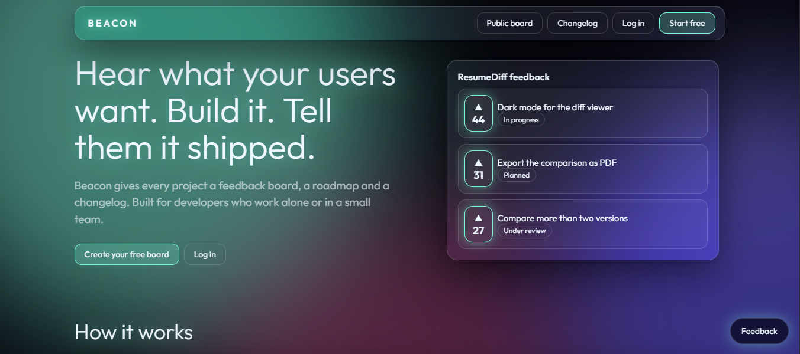
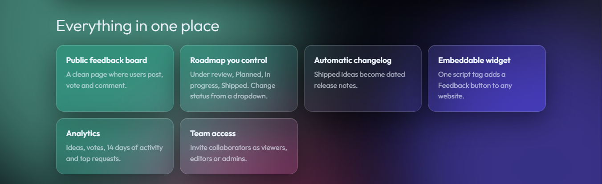
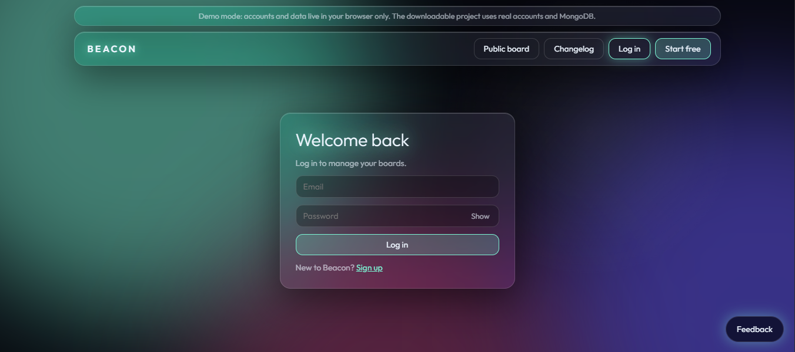
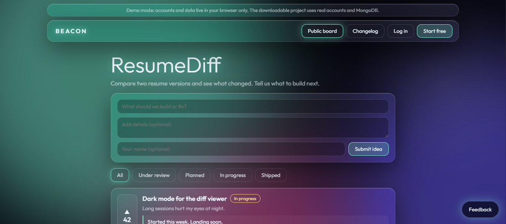
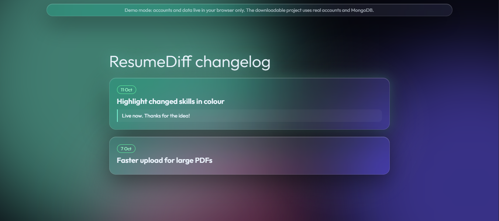

# Beacon

**Feedback boards, a public roadmap and a changelog for indie developers.**
Your users post and upvote ideas, you build the ones that matter, and every idea you ship becomes a release note automatically.




## Contents

- [Why Beacon](#why-beacon)
- [Features](#features)
- [Screenshots](#screenshots)
- [Architecture](#architecture)
- [Tech stack](#tech-stack)
- [Quick start](#quick-start)
- [Using Beacon](#using-beacon)
- [Accounts and permissions](#accounts-and-permissions)
- [Configuration](#configuration)
- [Project structure](#project-structure)
- [How it works](#how-it-works)
- [API reference](#api-reference)
- [Deployment](#deployment)
- [Security](#security)
- [Try the interface without a database](#try-the-interface-without-a-database)
- [Roadmap](#roadmap)
- [Contributing](#contributing)
- [License](#license)

## Why Beacon

When you launch a project on your own, feedback shows up in DMs, emails and random comments. You lose track of it, you cannot tell which request matters most, and the people who asked never find out whether you built it. Paid tools solve this, but they cost money a solo developer often does not have.

Beacon gives each project one public page for ideas, ranks them by votes, and publishes what you shipped. You can run your own copy for free.

## Features

- **Public feedback board** at `/p/your-project`. Visitors post ideas, upvote and comment without an account.
- **Voting** that ranks ideas by demand. One vote per visitor per idea, toggled on and off.
- **Roadmap** with four statuses: Under review, Planned, In progress, Shipped. Reply to the people who asked.
- **Automatic changelog** at `/p/your-project/changelog`. Marking an idea Shipped adds it with a date.
- **Embeddable widget**. One script tag adds a floating Feedback button to any website.
- **Analytics**: total ideas, total votes, new ideas over the last 14 days and your top requests.
- **Accounts**: signup, login, password change, sign out of other devices, account deletion.
- **Teams and roles**: invite collaborators as viewers, editors or admins.
- **Live updates**: boards and dashboards refresh on their own while the tab is open.
- **Interface**: aurora background, glassmorphism panels, glow accents and spring animations. Respects reduced motion.

## Screenshots

Screenshots were taken from the demo build described in [Try the interface without a database](#try-the-interface-without-a-database).

| | |
| --- | --- |
|  |  |
|  |  |

## Architecture

Beacon is two separate apps in one repository.

```
 Browser
    │  every request goes to the client
    ▼
┌──────────────────────┐   /api/* is proxied    ┌──────────────────────┐      ┌──────────────┐
│  client/  (Next.js)  │ ─────────────────────► │  server/  (Express)  │ ───► │   MongoDB    │
│  pages, UI, widget   │ ◄───────────────────── │  REST API, auth,     │ ◄─── │   (Atlas)    │
│  port 3000           │                        │  roles, validation   │      └──────────────┘
└──────────────────────┘                        │  port 4000           │
                                                └──────────────────────┘
```

- **`client/`** renders every page and the embeddable widget. It contains no database code and no secrets.
- **`server/`** owns the data. It exposes a JSON REST API, signs and verifies sessions, enforces roles and talks to MongoDB.
- The client forwards `/api/*` to the server (see `client/next.config.js`). Because the browser only ever talks to the client's address, the session cookie is first-party, and you need no CORS setup or third-party cookie workarounds.

## Tech stack

| Part | Tools |
| --- | --- |
| Client | Next.js 14 (App Router), React 18, TypeScript, Tailwind CSS, Framer Motion, custom CSS for glass and glow |
| Server | Node.js, Express 4, TypeScript, Mongoose, Zod, bcryptjs, jsonwebtoken, helmet, cors, cookie-parser |
| Database | MongoDB (Atlas free tier) |
| Hosting | Vercel for the client, Render for the server, Atlas for the database. All have free tiers |

## Quick start

### Prerequisites

- Node.js 18.17 or newer (20 recommended)
- A free [MongoDB Atlas](https://www.mongodb.com/atlas) account

### 1. Get the code

```bash
git clone https://github.com/manashwebdev/beacon.git
cd beacon
```

### 2. Create a MongoDB database

1. In Atlas, create a free (M0) cluster.
2. Under **Database Access**, create a user with a password.
3. Under **Network Access**, allow your IP address (use `0.0.0.0/0` for deployed apps).
4. Click **Connect**, choose **Drivers**, and copy the connection string. Put your database name (for example `beacon`) after the host.

### 3. Configure the server

```bash
cp server/.env.example server/.env
```

On Windows PowerShell use `copy server\.env.example server\.env`.

Open `server/.env` and set `MONGODB_URI` and `JWT_SECRET`. Generate a secret with:

```bash
node -e "console.log(require('crypto').randomBytes(32).toString('hex'))"
```

The client needs no configuration for local development. It expects the API at `http://localhost:4000`.

### 4. Run both apps

Open two terminals.

**Terminal 1: the server** (http://localhost:4000)

```bash
cd server
npm install
npm run dev
```

**Terminal 2: the client** (http://localhost:3000)

```bash
cd client
npm install
npm run dev
```

Open http://localhost:3000 in your browser. You can check the API at http://localhost:4000/api/health.

For a production build, run `npm run build` and then `npm start` inside each folder.

## Using Beacon

### As a project owner

1. Click **Start free** and create an account.
2. On the dashboard, create a project, for example "ResumeDiff". Beacon gives it a public link such as `/p/resumediff`.
3. Open the project and go to **Share and embed**. Copy the public link or the widget snippet.
4. Share the link with your users, or paste the snippet into your site.
5. As ideas arrive, open the **Roadmap** tab. Change an idea's status from its dropdown and write a reply for your users.
6. Set an idea to **Shipped** when you release it. It appears on your public changelog automatically.
7. Use the **Analytics** tab to see activity and your most requested ideas.

### As a visitor

1. Open the project's public link.
2. Post an idea, or upvote and comment on existing ones. No account is needed.
3. Check the changelog to see what has shipped.

### Add the widget to your site

Paste this before the closing `</body>` tag. Use the address of your deployed **client**, and your project's slug:

```html
<script src="https://your-app.vercel.app/widget.js" data-project="your-project-slug" defer></script>
```

An optional `data-color="#7cf5d4"` attribute changes the button's accent color. The widget opens your board in a panel inside the page.

### Add teammates

1. Ask your teammate to create a Beacon account.
2. Open your project, go to the **Team** tab, enter their account email and choose a role.
3. The project then appears on their dashboard with their role shown.

Anyone you add can leave the project themselves from the Team tab.

### Manage your account

Open **Account** from the top bar to change your name or password, sign out of other devices, or delete your account.

## Accounts and permissions

Login is required for `/dashboard` and `/account`. It is enforced in three layers:

1. `client/middleware.ts` redirects visitors who have no session cookie to `/login?next=...`, and they return to the page they wanted after logging in.
2. A server layout (`client/app/dashboard/layout.tsx` and `client/app/account/layout.tsx`) asks the API who the visitor is before anything renders. Deleted accounts and signed-out sessions are turned away.
3. Every protected API route in `server/` verifies the session and the caller's role again.

Roles are checked on the server for every request (see `server/src/lib/access.ts` and `server/src/lib/guard.ts`):

| Role | Can do |
| --- | --- |
| Viewer | Read the dashboard and analytics |
| Editor | Also change status, reply to users and comment as the team |
| Admin | Also delete ideas and add, change or remove editors and viewers |
| Owner | Also add, change or remove admins and delete the project |

A project can have up to 20 team members and each account can own up to 20 projects.

## Configuration

**Server** (`server/.env`)

| Variable | Required | Description |
| --- | --- | --- |
| `MONGODB_URI` | Yes | MongoDB connection string |
| `JWT_SECRET` | Yes in production | Secret used to sign session tokens. The server refuses to start in production without it |
| `PORT` | No | Port to listen on. Defaults to 4000 |
| `CLIENT_URL` | No | Comma-separated origins allowed to call the API directly from a browser (CORS). Not needed with the default proxy setup |

**Client** (`client/.env.local`)

| Variable | Required | Description |
| --- | --- | --- |
| `API_URL` | In production | Address of the server, for example `https://beacon-api.onrender.com`. Defaults to `http://localhost:4000` |

## Project structure

The repository has five top-level entries: `client/`, `server/`, `docs/`, `LICENSE` and `README.md`. Each app has its own `package.json` and `.gitignore`.

```
beacon/
├── client/                        Next.js app (everything the visitor sees)
│   ├── app/
│   │   ├── page.tsx               Landing page
│   │   ├── login/, signup/        Auth pages
│   │   ├── account/               Account settings (login required)
│   │   ├── dashboard/             Projects and project management (login required)
│   │   ├── p/[slug]/              Public board and changelog
│   │   └── embed/[slug]/          Board shown inside the widget
│   ├── components/                Board, Manage, Nav, AuthForm, HeroCTA, MockBoard, Aurora
│   ├── lib/
│   │   ├── client.ts              Fetch helper and polling hook (browser)
│   │   └── server.ts              Calls the API from Server Components
│   ├── public/widget.js           Embeddable feedback widget
│   ├── middleware.ts              Redirects visitors with no session cookie
│   └── next.config.js             Proxies /api/* to the server
├── server/                        Express API
│   └── src/
│       ├── index.ts               Starts the server and connects to MongoDB
│       ├── app.ts                 Express app: security headers, routes, error handling
│       ├── models.ts              User, Project, Post, Comment
│       ├── routes/                auth, account, projects (and team), public, posts
│       ├── middleware/auth.ts     requireAuth and optionalAuth
│       └── lib/                   auth, access (roles), guard, rate, validators, util, http
├── docs/
│   ├── screenshots/               Images used in this README
│   └── demo/index.html            Standalone demo of the interface
├── LICENSE
└── README.md
```

## How it works

- **Sessions.** Logging in sets a signed JWT in an httpOnly, SameSite=Lax cookie (Secure in production) that lasts 7 days. Each user has a `tokenVersion` stored inside the token. Changing your password or choosing "Sign out of other devices" increases it, which invalidates every older session.
- **Anonymous voting.** The browser creates a random id, keeps it in localStorage and sends it as the `x-voter` header. The server records one vote per id per idea using `$addToSet` and `$pull`.
- **Live updates.** The public board refreshes every 6 seconds and the dashboard every 8 seconds while the tab is visible.
- **Changelog.** Setting an idea's status to Shipped stores a `shippedAt` date. The changelog page is rendered on the client's server from the API's shipped ideas.
- **Widget.** `client/public/widget.js` adds a button and an iframe that loads `/embed/[slug]`.
- **Analytics.** Totals, a 14-day series and the top requests are computed in `GET /api/projects/:id`.

## API reference

The server exposes these routes under `/api`. Through the client's proxy they are reachable at the same paths on the client's address.

| Method and path | Access | Purpose |
| --- | --- | --- |
| `GET /api/health` | Public | Health check |
| `POST /api/auth/signup` | Public | Create an account and start a session |
| `POST /api/auth/login` | Public | Log in |
| `POST /api/auth/logout` | Public | End the session |
| `GET /api/auth/me` | Public | Current user, or `null` |
| `PATCH /api/account` | Signed in | Change your name |
| `DELETE /api/account` | Signed in | Delete your account (needs your password) |
| `POST /api/account/password` | Signed in | Change password and sign out other devices |
| `POST /api/account/sessions` | Signed in | Sign out other devices |
| `GET /api/projects` | Signed in | Projects you own or belong to, with your role |
| `POST /api/projects` | Signed in | Create a project |
| `GET /api/projects/:id` | Viewer and up | Dashboard data and analytics |
| `DELETE /api/projects/:id` | Owner | Delete a project |
| `GET /api/projects/:id/members` | Viewer and up | List the team |
| `POST /api/projects/:id/members` | Admin and up | Add a person by account email |
| `PATCH /api/projects/:id/members` | Admin and up | Change a person's role |
| `DELETE /api/projects/:id/members/:userId` | Admin and up, or yourself | Remove a person, or leave |
| `GET /api/p/:slug` | Public | Board data |
| `POST /api/p/:slug/posts` | Public | Submit an idea |
| `GET /api/p/:slug/changelog` | Public | Shipped ideas |
| `POST /api/posts/:id/vote` | Public | Toggle your vote |
| `GET /api/posts/:id/comments` | Public | List comments |
| `POST /api/posts/:id/comments` | Public | Add a comment (marked Team for editors and up) |
| `PATCH /api/posts/:id` | Editor and up | Change status or reply |
| `DELETE /api/posts/:id` | Admin and up | Delete an idea |

All request bodies are validated with Zod. Errors return JSON in the form `{ "error": "message" }`.

## Deployment

Deploy the server first, then the client.

### 1. Database (MongoDB Atlas)

Create the cluster as described in [Quick start](#2-create-a-mongodb-database). Under **Network Access**, allow `0.0.0.0/0` so your hosted server can connect.

### 2. Server on Render

1. Push the repository to GitHub.
2. In [Render](https://render.com), create a **Web Service** from the repository.
3. Set **Root Directory** to `server`.
4. Set **Build Command** to `npm install --include=dev && npm run build`. The `--include=dev` part makes sure TypeScript is installed even when `NODE_ENV=production`.
5. Set **Start Command** to `npm start`.
6. Add environment variables: `MONGODB_URI`, `JWT_SECRET` and `NODE_ENV=production`.
7. Set the **Health Check Path** to `/api/health`.
8. Deploy and note the address, for example `https://beacon-api.onrender.com`.

Render's free plan puts a service to sleep after a period of inactivity, so the first request after a quiet spell can take up to a minute.

### 3. Client on Vercel

1. In [Vercel](https://vercel.com), import the same repository.
2. Set **Root Directory** to `client`.
3. Add the environment variable `API_URL` with your Render address (no trailing slash).
4. Deploy. If you change `API_URL` later, redeploy so the proxy picks it up.

Use your Vercel address in the widget snippet.

## Security

What Beacon does:

- Passwords are hashed with bcrypt. They need 8+ characters with a letter and a number.
- Session cookies are httpOnly, SameSite=Lax and Secure in production.
- The signing secret exists only on the server. The client never sees it.
- Sessions can be revoked: changing your password or choosing "Sign out of other devices" signs out every other device.
- Login attempts are limited to 20 per minute per IP. An account locks for 15 minutes after 8 wrong passwords.
- Permissions are checked on the server for every request, never only in the interface.
- Request bodies are validated with Zod, bodies are capped at 50 KB, helmet sets security headers, and user content is escaped when displayed.

Known limits:

- Rate limiting is stored in memory, so it resets when the server restarts and is per instance. Use a shared store such as Redis if you run several instances or need strict limits.
- Rate limits use the first address in `X-Forwarded-For`, which assumes the server runs behind a trusted proxy such as Render.
- Anonymous voting identifies a browser, not a person. Someone determined can vote more than once by clearing storage.
- There is no password reset by email yet.

## Try the interface without a database

`docs/demo/index.html` is a single file you can open in any browser. It shows the full interface (landing page, signup and login, board, dashboard, roles, changelog) with sample data. Accounts and data stay in your browser, and a "Viewing as" switch on the dashboard lets you see what each role can do. It is a demo of the interface only. The real application is the `client/` and `server/` code in this repository.

## Roadmap

- Password reset by email
- Sign in with GitHub
- Email notifications when an idea ships
- Server-Sent Events instead of polling
- Custom domains for public boards
- Tests (unit tests for access rules, end-to-end tests for the main flows)

## Contributing

Issues and pull requests are welcome. For larger changes, open an issue first so we can talk it through. Please keep changes focused and match the existing code style.

## License

Beacon is released under the [MIT License](LICENSE). Copyright (c) 2026 Manash Khati.
